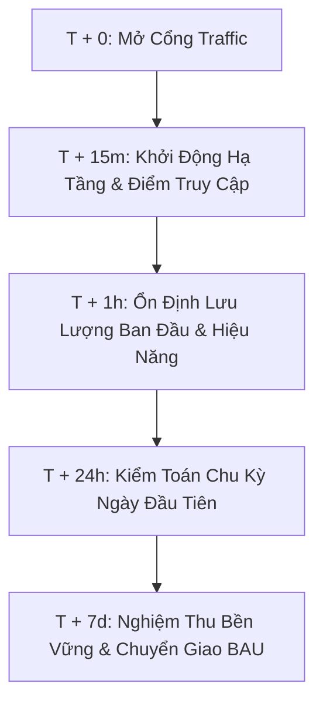

# REVIEW_HYPERCARE & INCIDENT ESCALATION.md — Khung Quản Trị Giám Sát Sau Triển Khai & Leo Thang Sự Cố (Hypercare Period)

> **Tài liệu kiểm định chuyên biệt (Production Readiness Review - Governance Domain 03 / 04)**  
> **Đơn vị phụ trách**: Incident Commander & Principal SRE & Lead Backend Engineer  
> **Tài liệu tham chiếu**: [REVIEW.md](REVIEW.md) · [Architecture.md](../../Architecture.md) · [AGENTS.md](../../AGENTS.md)

---

## 1. Tổng Quan Giai Đoạn Giám Sát Tăng Cường (Hypercare Period)

Sau khi hệ thống tiếp nhận lưu lượng truy cập thực tế của người dùng, Ban Chỉ đạo và Nhóm Kỹ sư Trực vận hành (On-call Team) kích hoạt chế độ **Giám sát Tăng cường (Hypercare Period)** trong vòng 7 ngày đầu theo 4 mốc then chốt:

---

## 2. Khung Thời Gian & Trọng Tâm Điều Hành Giám Sát

| Mốc Thời Gian | Trọng Tâm Điều Hành & Mục Tiêu Nghiệm Thu | Tệp Kiểm Định Chuyên Trách Hướng Dẫn |
| :---: | :--- | :--- |
| **T + 15 Phút** | **Cổng Khởi Động Hạ Tầng & Điểm Truy Cập**: Xác nhận 100% Pods dịch vụ và MCP tools khởi động thành công; Ingress và mạng lưới phân phối lưu lượng trực tuyến an toàn. | [REVIEW_KUBERNETES & SRE.md](REVIEW_KUBERNETES%20&%20SRE.md) [REVIEW_OBSERVABILITY & ALERTING.md](REVIEW_OBSERVABILITY%20&%20ALERTING.md) [REVIEW_CI-CD & GITOPS.md](REVIEW_CI-CD%20&%20GITOPS.md) |
| **T + 1 Giờ** | **Cổng Ổn Định Lưu Lượng Ban Đầu & Hiệu Năng**: Đánh giá trải nghiệm người dùng thực tế ban đầu; kiểm soát độ trễ phản hồi, tỷ lệ lỗi dịch vụ, tỷ lệ trúng bộ đệm và xác nhận hệ thống cảnh báo vận hành bình thường. | [REVIEW_ARCHITECTURE & PROTOCOLS.md](REVIEW_ARCHITECTURE%20&%20PROTOCOLS.md) [REVIEW_MULTI-TIER CACHING SUBSYSTEM.md](REVIEW_MULTI-TIER%20CACHING%20SUBSYSTEM.md) [REVIEW_MODEL GATEWAY & INFERENCE.md](REVIEW_MODEL%20GATEWAY%20&%20INFERENCE.md) [REVIEW_OBSERVABILITY & ALERTING.md](REVIEW_OBSERVABILITY%20&%20ALERTING.md) |
| **T + 24 Giờ** | **Cổng Kiểm Toán Chu Kỳ Ngày Đầu Tiên**: Thực hiện rà soát toàn diện sau 1 ngày vận hành đầy đủ về: mức tiêu thụ tài nguyên và ngân sách token, độ ổn định của pool kết nối CSDL, hàng đợi phê duyệt rủi ro, sao lưu dữ liệu và kiểm toán bảo vệ dữ liệu cá nhân. | [REVIEW_STATE, MEMORY & PERSISTENCE.md](REVIEW_STATE,%20MEMORY%20&%20PERSISTENCE.md) [REVIEW_SECURITY, GUARDRAILS & HITL.md](REVIEW_SECURITY,%20GUARDRAILS%20&%20HITL.md) [REVIEW_QUALITY GATES - DEEPEVAL & RAGAS.md](REVIEW_QUALITY%20GATES%20-%20DEEPEVAL%20&%20RAGAS.md) [REVIEW_SRE & DISASTER RECOVERY.md](REVIEW_SRE%20&%20DISASTER%20RECOVERY.md) [REVIEW_FINOPS & COST GOVERNANCE.md](REVIEW_FINOPS%20&%20COST%20GOVERNANCE.md) [REVIEW_COMPLIANCE, PRIVACY & AI ETHICS.md](REVIEW_COMPLIANCE,%20PRIVACY%20&%20AI%20ETHICS.md) [REVIEW_DATA GOVERNANCE & RAG RBAC.md](REVIEW_DATA%20GOVERNANCE%20&%20RAG%20RBAC.md) |
| **T + 7 Ngày** | **Cổng Nghiệm Thu Bền Vững & Chuyển Giao Vận Hành Tiêu Chuẩn (BAU)**: Hoàn tất chu kỳ tuần đầu tiên; diễn tập khôi phục thảm họa định kỳ, đối soát tài chính thực tế so với mô hình dự toán và chính thức bàn giao sang chế độ vận hành thường lệ. | [REVIEW_SRE & DISASTER RECOVERY.md](REVIEW_SRE%20&%20DISASTER%20RECOVERY.md) [REVIEW_FINOPS & COST GOVERNANCE.md](REVIEW_FINOPS%20&%20COST%20GOVERNANCE.md) [REVIEW_TESTING & QA STRATEGY.md](REVIEW_TESTING%20&%20QA%20STRATEGY.md) |

---

## 3. Quy Trình Leo Thang Sự Cố (Incident Escalation Protocol)

1. **Mức Độ Khẩn Cấp 1 (P0 Incident — Downtime / Data Leak / Model Crash)**:
   - **Thời gian phản hồi On-call**: $< 5$ phút.
   - **Quy trình xử lý**: Incident Commander kích hoạt ngay phòng họp ứng cứu khẩn cấp (War Room); nếu thời gian khắc phục $> 15$ phút, thực hiện quy trình hoàn nguyên phiên bản khẩn cấp (Emergency Rollback) theo [REVIEW_SRE & DISASTER RECOVERY.md](REVIEW_SRE%20&%20DISASTER%20RECOVERY.md).
2. **Mức Độ Nghiêm Trọng 2 (P1 Incident — High Latency / Low Groundedness / GPU Failover)**:
   - **Thời gian phản hồi On-call**: $< 15$ phút.
   - **Quy trình xử lý**: Kỹ sư phụ trách domain phân tích log truy vết OpenTelemetry, kiểm tra trạng thái Circuit Breaker và điều chỉnh tham số cấu hình/routing model.
3. **Mức Độ Suy Giảm 3 & 4 (P2/P3 Incident — Minor Errors / Deprecations)**:
   - **Thời gian phản hồi**: Trong ngày làm việc tiếp theo.
   - **Quy trình xử lý**: Ghi nhận mã lỗi, phân loại và đưa vào Jira backlog của sprint tiếp theo.

---

## 4. Tiêu Chí Đóng Giai Đoạn Hypercare (Exit Hypercare Criteria)

Giai đoạn Hypercare chỉ được xem là hoàn tất và chính thức chuyển giao sang đội ngũ Vận hành Tiêu chuẩn (BAU) khi thỏa mãn đồng thời 3 điều kiện:
- **Độ ổn định hệ thống**: Không phát sinh bất kỳ sự cố P0 nào chưa giải quyết trong 72 giờ liên tục.
- **Tiêu chuẩn nghiệm thu tuần**: 100% các tiêu chí giám sát tại mốc `T+7 Ngày` trong 14 tệp chuyên biệt đều đạt trạng thái nghiệm thu.
- **Phê chuẩn tài chính & chất lượng**: Báo cáo đối soát tài chính FinOps và báo cáo kiểm toán chất lượng AI tuần đầu tiên được Lead Architect và Finance Lead phê duyệt.

---

## 6. Bằng Chứng Kiểm Định Tự Động (Auto-Evidence Status)

> **AUTO-EVIDENCE PENDING** — chờ đối soát và **ký bởi Release Board**. Không có nhãn `PASSED` được tự động gán cho tài liệu này.

- Artifact: [evidence/prr/latest.json](../../evidence/prr/latest.json) (`commit_sha`, `timestamp_utc`, exit code của `ruff` / `mypy --no-incremental` / `pytest -n auto --cov=src --cov-fail-under=85` / `eval --mode smoke` / `red_teaming_runner` / `restore_drill --smoke` / parse YAML).
- Sinh artifact: `python scripts/generate_prr_evidence.py`. Tất cả ô trạng thái `[]` ở các mục trên vẫn giữ nguyên cho đến khi Hội đồng đối soát artifact và ký duyệt.
- Bảng chữ ký 9 đại diện: [REVIEW.md mục 6.3](REVIEW.md#63-bảng-chữ-ký-phê-chuẩn-của-hội-đồng-đánh-giá).
