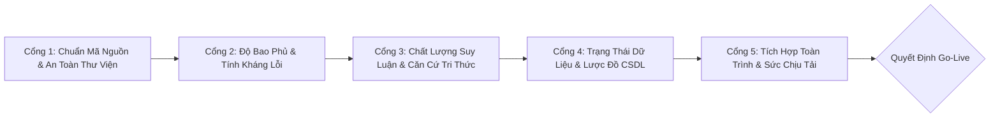

# REVIEW_PRE-FLIGHT STAGE GATES.md — Quy Trình Điều Phối 5 Cổng Diễn Tập Trước Giờ G (Pre-Flight Protocol)

> **Tài liệu kiểm định chuyên biệt (Production Readiness Review - Governance Domain 02 / 04)**  
> **Đơn vị phụ trách**: Release Board & QA / Test Engineering Lead & Principal SRE  
> **Tài liệu tham chiếu**: [REVIEW.md](file:///f:/PROJECTS/AIAgent/.workflows/reviews/REVIEW.md) · [Architecture.md](file:///f:/PROJECTS/AIAgent/Architecture.md) · [AGENTS.md](file:///f:/PROJECTS/AIAgent/AGENTS.md)

---

## 1. Tổng Quan Quy Trình Diễn Tập (Stage Gate Protocol)

Trước thời điểm kích hoạt phát hành Production, Ban Đánh giá Phát hành (Release Board) điều phối quy trình diễn tập liên ngành tuần tự qua 5 cổng kiểm soát chất lượng (Stage Gates):



---

## 2. Đặc Tả Chi Tiết 5 Cổng Kiểm Soát Chất Lượng

### Cổng 1: Chuẩn Mã Nguồn Tĩnh & An Toàn Thư Viện (Code Quality & Security Baseline Gate)
- **Mục tiêu điều phối**: Đảm bảo mã nguồn đạt chuẩn mực tĩnh, không có lỗi type hints, và danh mục thư viện phụ thuộc sạch bóng các lỗ hổng bảo mật nghiêm trọng.
- **Đơn vị chủ trì**: DevOps / Release Lead & Lead Backend Engineer.
- **Tài liệu kiểm định & câu lệnh chi tiết**: [REVIEW_CI-CD & GITOPS.md](file:///f:/PROJECTS/AIAgent/.workflows/reviews/REVIEW_CI-CD%20&%20GITOPS.md).
- **Tiêu chí nghiệm thu mở cổng**: 100% tiêu chí P0 đạt, 0 cảnh báo lint/type check, 0 lỗ hổng bảo mật Critical trong phụ thuộc.
- **Lệnh thực thi mẫu**:
  ```bash
  uv run ruff check .
  uv run mypy src/
  uv run pip-audit
  ```

### Cổng 2: Độ Bao Phủ Kiểm Thử & Tính Bền Vững Kháng Lỗi (Testing & Resilience Gate)
- **Mục tiêu điều phối**: Kiểm định tính toàn vẹn của kim tự tháp kiểm thử phần mềm, độ bao phủ mã nguồn theo cam kết SLA, và năng lực tự phục hồi khi có sự cố hạ tầng.
- **Đơn vị chủ trì**: QA / Test Engineering Lead.
- **Tài liệu kiểm định & câu lệnh chi tiết**: [REVIEW_TESTING & QA STRATEGY.md](file:///f:/PROJECTS/AIAgent/.workflows/reviews/REVIEW_TESTING%20&%20QA%20STRATEGY.md).
- **Tiêu chí nghiệm thu mở cổng**: Toàn bộ 110+ test cases Pass, Code Coverage $\ge 85\%$ (Core $\ge 95\%$), kịch bản Chaos Resilience vượt qua thành công.
- **Lệnh thực thi mẫu**:
  ```bash
  uv run pytest tests/unit tests/integration --cov=src --cov-report=term-missing
  ```

### Cổng 3: Chất Lượng Suy Luận & Căn Cứ Tri Thức (AI Quality & Grounding Gate)
- **Mục tiêu điều phối**: Đánh giá năng lực của tác tử trong việc định tuyến chính xác yêu cầu, trả lời trung thực bám sát tài liệu nguồn và ngăn chặn rủi ro ảo giác.
- **Đơn vị chủ trì**: AI Evaluation Lead & Data Governance Lead.
- **Tài liệu kiểm định & câu lệnh chi tiết**: [REVIEW_QUALITY GATES - DEEPEVAL & RAGAS.md](file:///f:/PROJECTS/AIAgent/.workflows/reviews/REVIEW_QUALITY%20GATES%20-%20DEEPEVAL%20&%20RAGAS.md) và [REVIEW_DATA GOVERNANCE & RAG RBAC.md](file:///f:/PROJECTS/AIAgent/.workflows/reviews/REVIEW_DATA%20GOVERNANCE%20&%20RAG%20RBAC.md).
- **Tiêu chí nghiệm thu mở cổng**: Vượt qua toàn bộ các ngưỡng chỉ số chất lượng quy định tại khung đánh giá tự động (Faithfulness $\ge 0.90$, Answer Relevance $\ge 0.85$, Routing Precision $\ge 0.95$).

### Cổng 4: Trạng Thái Dữ Liệu & Tiến Hóa Lược Đồ (Data Persistence & Schema Gate)
- **Mục tiêu điều phối**: Bảo đảm sự sẵn sàng của lược đồ cơ sở dữ liệu quan hệ, tính tương thích của hệ thống điều phối kết nối, và độ toàn vẹn của bộ nhớ phiên.
- **Đơn vị chủ trì**: Lead Backend Engineer & Database Administrator (DBA).
- **Tài liệu kiểm định & câu lệnh chi tiết**: [REVIEW_STATE, MEMORY & PERSISTENCE.md](file:///f:/PROJECTS/AIAgent/.workflows/reviews/REVIEW_STATE,%20MEMORY%20&%20PERSISTENCE.md).
- **Tiêu chí nghiệm thu mở cổng**: Đồng bộ di chuyển lược đồ CSDL lên phiên bản mới nhất thành công, không xung đột kết nối, chữ ký HMAC dữ liệu hợp lệ.
- **Lệnh thực thi mẫu**:
  ```bash
  alembic upgrade head
  ```

### Cổng 5: Tích Hợp Toàn Trình & Sức Chịu Tải Hệ Thống (E2E Integration & Stress Gate)
- **Mục tiêu điều phối**: Kiểm tra các điểm kiểm soát sức khỏe ứng dụng, luồng truyền phát trực tuyến phản hồi, diễn tập quy trình phê duyệt rủi ro cao và đo lường sức chịu tải đồng thời.
- **Đơn vị chủ trì**: Chief AI Architect, SecOps Lead & QA Lead.
- **Tài liệu kiểm định & câu lệnh chi tiết**: [REVIEW_ARCHITECTURE & PROTOCOLS.md](file:///f:/PROJECTS/AIAgent/.workflows/reviews/REVIEW_ARCHITECTURE%20&%20PROTOCOLS.md), [REVIEW_SECURITY, GUARDRAILS & HITL.md](file:///f:/PROJECTS/AIAgent/.workflows/reviews/REVIEW_SECURITY,%20GUARDRAILS%20&%20HITL.md), và [REVIEW_TESTING & QA STRATEGY.md](file:///f:/PROJECTS/AIAgent/.workflows/reviews/REVIEW_TESTING%20&%20QA%20STRATEGY.md).
- **Tiêu chí nghiệm thu mở cổng**: Luồng truyền dữ liệu phản hồi SSE ổn định, kịch bản phê duyệt HITL hoạt động an toàn, hệ thống vượt qua bài kiểm tra chịu tải định mức (100 req/s, P99 latency $< 2.5s$).

---

## 3. Quy Tắc Bàn Giao Giữa Các Cổng (Stage Handover Rule)

> [!IMPORTANT]
> **Nguyên Tắc Bàn Giao Nghiêm Ngặt (Stage Handover Rule)**: Trình tự thực hiện bắt buộc phải tuần tự từ Cổng 1 đến Cổng 5. Bất kỳ cổng nào phát sinh lỗi mức P0 chưa được giải quyết thì toàn bộ quy trình diễn tập lập tức tạm dừng để khắc phục, không được phép chuyển cổng hoặc bypass.

---

## 6. Bằng Chứng Kiểm Định Tự Động (Auto-Evidence Status)

> **AUTO-EVIDENCE PENDING** — chờ đối soát và **ký bởi Release Board**. Không có nhãn `PASSED` được tự động gán cho tài liệu này.

- Artifact: [evidence/prr/latest.json](file:///f:/PROJECTS/AIAgent/evidence/prr/latest.json) (`commit_sha`, `timestamp_utc`, exit code của `ruff` / `mypy` / `pytest --collect-only` / `eval --mode smoke` / parse YAML).
- Sinh artifact: `python scripts/generate_prr_evidence.py`. Tất cả ô trạng thái `[]` ở các mục trên vẫn giữ nguyên cho đến khi Hội đồng đối soát artifact và ký duyệt.
- Bảng chữ ký 9 đại diện: [REVIEW.md mục 6.3](file:///f:/PROJECTS/AIAgent/.workflows/reviews/REVIEW.md#63-bảng-chữ-ký-phê-chuẩn-của-hội-đồng-đánh-giá).
